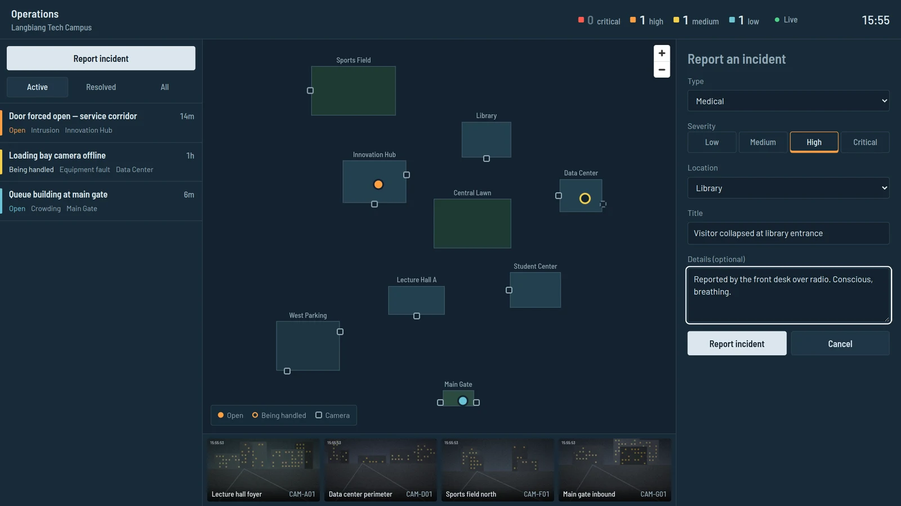

# Example runs on ops-command-center

Three real pipeline runs against
[ops-command-center](https://github.com/truongtankhanh/ops-command-center), a NestJS + React
monorepo. The artifacts are copied unedited from the run folders (`.steel/runs/…`); the code
they produced is in that repository's history.

| Run                                                                         | Pipeline            | What it did                                                                     | Result in ops-command-center                                                                                                                   |
| --------------------------------------------------------------------------- | ------------------- | ------------------------------------------------------------------------------- | ---------------------------------------------------------------------------------------------------------------------------------------------- |
| [`task-occ-27`](task-occ-27/)                                               | task (4 stages)     | Ticket OCC-27: let operators report an incident from the console                | [`b7da1da`](https://github.com/truongtankhanh/ops-command-center/commit/b7da1da) feat(console): report an incident from the console            |
| [`review-feat-occ-27-report-incident`](review-feat-occ-27-report-incident/) | review (4 stages)   | Diff-scoped self-review of that branch: 4 findings, 2 fixed, 2 kept by decision | [`b8954ba`](https://github.com/truongtankhanh/ops-command-center/commit/b8954ba) fix(console): announce the report action as expanding a panel |
| [`api-docs-2026-10-01`](api-docs-2026-10-01/)                               | api-docs (3 stages) | First documentation run: 11 endpoints and events, OpenAPI 3.1                   | [`bf3fcb3`](https://github.com/truongtankhanh/ops-command-center/commit/bf3fcb3) docs(api): add API reference generated from the code          |

## Things worth noticing

- **The task run never committed.** `04-verify.md` ends with a suggested commit message; the
  human made the commit.
- **Assumptions are visible.** `01-analyze.md` marks two `[ASSUMPTION]`s (position defaults to
  the zone centre; no preselected type) instead of silently deciding.
- **Verification is evidence, not adjectives.** Each check in `04-verify.md` has its exit code and
  output, including a two-browser manual test that the new incident reached a second console live.
- **The self-review only touched the branch's own lines.** `04-verify.md` lists every changed
  line against the scan's line map. Two pre-existing issues it noticed are `[OUT OF SCOPE]` and
  became follow-ups instead of drive-by edits.
- **The review found a real defect in reviewed code.** The task run's own verify stage passed, yet
  the self-review caught an `aria-pressed` misuse (R1) — the two pipelines look for different
  things.
- **Docs carry their own drift detector.** Each endpoint in the generated docs has a
  `<!-- steel:endpoint … -->` signature marker; the next `api-docs-scan` compares those against
  the code and reports `new`, `changed` or `removed` endpoints instead of rewriting everything.
